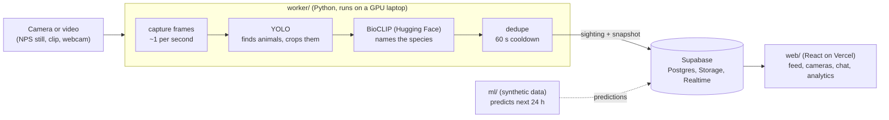

# En-Vision (Animal Logger)

A wildlife sighting log for parks. Cameras feed a Python worker that **detects animals (YOLO)**, **names the species (BioCLIP, a Hugging Face model)**, and logs each sighting to Supabase. A React web app shows a live feed of recent sightings (species, camera, time), a prediction card ("Predicting an elk around 6:30 AM"), charts, and a chat room for visitors. It opens on a 3D globe of seven national parks (Yellowstone and Katmai have cameras; Yosemite, Everglades, Grand Canyon, Great Smoky Mountains and Denali show "cameras coming soon"), where visitors can also drop anonymous sighting pings. It installs as a PWA.

Built for KnightHacks 2026. Tracks: **Best First Time**, **Best AI Hack**, **Best Use of a Hugging Face Model**.

> **Honest status:** the AI pipeline is real and tested on public-domain Yellowstone footage, but the live Yellowstone cam rarely shows animals, so the demo runs on recorded clips (labelled "Demo clip"). The predictions are trained on **synthetic** data. See [Status](#status-what-is-real-and-what-is-not).

## How it works



- **Detect:** YOLO (Ultralytics) finds animal-shaped regions in a frame and crops them.
- **Identify:** BioCLIP (`imageomics/bioclip` on the Hugging Face Hub) scores each crop against a short, per-park list of candidate species (`worker/species.json`). No training needed.
- **Dedupe:** the same species on the same camera inside 60 seconds is one sighting.
- **Store and show:** the worker writes straight to Supabase; the web app reads it and updates live. There is no custom API server.
- **Demo vs Live:** every sighting is tagged `source_kind` = `live` (from the live camera) or `replay` (recorded clips and seed data). The web app's **Demo / Live** switch and the bubble on each camera view make that visible, and Live never falls back to the demo clip.

## Status: what is real and what is not

| Part | State |
|---|---|
| Worker (capture, YOLO, BioCLIP, dedupe, Supabase write) | Real. 82 tests pass without models (1 skipped). Ran end to end on a public-domain NPS bison clip on a GPU; crops from three clips were used to tune BioCLIP. |
| Species ID accuracy | **About 59% of crops correct on the hardest clips** (bison calves and body fragments, after tuning the BioCLIP prompt). Adult bison in clear view scored 0.93 to 1.00. |
| Live cam (NPS Yellowstone "Electric Peak") | Plumbing works (image URL polling, Live mode). The cam is a wide landscape and **showed no animals in the first 348 collected frames**; tiny distant animals would likely be missed by YOLO. Tiled detection is available in `folder_scanner`. |
| Web app | Real. Lint, build, 29 unit tests and a headless-browser route check pass. Runs on mock data without keys. Not yet tested on a real phone or GPU. |
| Katmai detector | A reviewed two-class (bear, bird) YOLO model; all six bear detections on a 147-image holdout were confirmed. Weights are local only (`worker/training/katmai/current.pt`). See [ml/KATMAI.md](ml/KATMAI.md). |
| Katmai analytics | Real public data (NPS species list, GBIF occurrences, NASA POWER weather), with sample sizes and caveats shown on the page. |
| iNaturalist data | ~43k real research-grade observations for the seven parks in `ml/data/inat/`. Used for park species lists; the prediction model does not use it yet. |
| Chat and comments | Real code and SQL, **never run against a real Supabase project yet**; without keys they run on an in-memory sample. |
| Predictions (`ml/`) | **Trained on synthetic data** (made-up hour-of-day patterns). The simple hourly profile beat gradient boosting; results are optimistic. See [ml/README.md](ml/README.md). |
| Supabase and Vercel | SQL and a setup wizard exist; nothing has been verified end to end against a live project. |

## Demo day: what to run

Needs the worker venv and the Supabase keys in `.env`. From `worker/`, each in its own terminal:

```bash
# 1. Demo mode (required): real YOLO + BioCLIP on recorded NPS bison clips, looping forever,
#    one sighting about every 10 s, tagged source_kind=replay (shown under Demo in the app).
.venv/bin/python -m animal_worker.main --demo --source sample_videos/nps \
  --camera "Lamar Valley Demo Cam" --park yellowstone --min-confidence 0.9

# 2. Live moment (optional): the NPS Electric Peak still, polled every 60 s, tagged live.
.venv/bin/python -m animal_worker.main --source https://www.nps.gov/webcams-yell/mammoth_electric.jpg \
  --camera "Electric Peak Cam" --park yellowstone --every 60

# 3. Katmai (optional talking point): three bear cams through the reviewed bear/bird model.
#    Needs training/katmai/current.pt. Bear season is over, so rows are tagged replay.
.venv/bin/python -m animal_worker.katmai_live --every 60 --publish
```

Then open the web app (`cd web && npm run dev`, or the deployed site) and switch to **Demo** to watch sightings arrive. Add `--dry-run` to any command to print sightings without writing to Supabase. `--min-confidence 0.9` hides the occasional "Elk" guess on the bison clips (bison score 0.98 to 1.00). Ctrl+C stops each one.

## Quick start

Prerequisites: Node 18+ and npm; Python 3.10 to 3.12 for the worker (torch wheels may not exist for 3.13+); git. A GPU (CUDA) is optional but makes the worker much faster.

### 1. Web app (works immediately, on mock data)
```bash
cd web
npm install
npm run dev          # also: npm run lint | build | test
```
With no keys in `.env` it shows clearly labelled mock sightings, sample chat and sample predictions.

### 2. Supabase and Vercel (real data and a public site)
Needs a human with accounts. The guided way:
```bash
bash scripts/setup-supabase-vercel.sh
```
It walks through creating the Supabase project, running the SQL files, writing `.env`, checking the API, deploying to Vercel, and a worker smoke test.

By hand:
1. Create a project at supabase.com. In the SQL editor run, in order: `supabase/schema.sql`, `supabase/social.sql`, `supabase/pings.sql`, `supabase/katmai-cams.sql`, then (optional, **synthetic** demo data, fresh database only) `supabase/seed.sql`.
2. `cp .env.example .env` and fill in `SUPABASE_URL`, `SUPABASE_SERVICE_ROLE_KEY` (worker, **secret**), `VITE_SUPABASE_URL` and `VITE_SUPABASE_ANON_KEY` (web, public). `.env` is gitignored; never commit it.
3. **Vercel:** import this repo, Root Directory `web`, framework Vite, and add the two `VITE_` variables. (If you use Vercel's Supabase integration instead, its `NEXT_PUBLIC_SUPABASE_URL` and `NEXT_PUBLIC_SUPABASE_ANON_KEY` work too; the app reads either set.) The worker cannot run on Vercel; run it on a laptop.

### 3. Worker
```bash
cd worker
python3.12 -m venv .venv && source .venv/bin/activate     # or: uv venv --python 3.12 .venv
pip install torch torchvision --index-url https://download.pytorch.org/whl/cu124   # CUDA; use .../whl/cpu without a GPU
pip install -r requirements.txt
python -m pytest                                           # needs no models
```
Edit `worker/species.json` for your park (currently Yellowstone; BioCLIP picks from that list).

**Replay a recorded clip** (no database, no keys):
```bash
python -m animal_worker.main --source sample_videos/nps/yell-Bison00772MTS_1280x720.mp4 --camera "Demo Cam" --dry-run
```
Files and clips are tagged `source_kind=replay`. Public-domain bison clips come from the [NPS Yellowstone video library](https://www.nps.gov/yell/learn/photosmultimedia/vl_bisoncalves.htm); put them in `worker/sample_videos/` (gitignored). Drop `--dry-run` to write to Supabase (needs `.env`).

**Live camera** (NPS Yellowstone "North Entrance - Electric Peak", a still refreshed every 30 to 60 s; image credit: National Park Service):
```bash
python -m animal_worker.main --source https://www.nps.gov/webcams-yell/mammoth_electric.jpg --camera "Electric Peak Cam" --park yellowstone --dry-run
```
An image-URL source is polled every `--every` seconds (default 60, minimum 30) and tagged `source_kind=live`; override with `--source-kind`. It stops on the first fetch error. Please be gentle: do not poll faster than 30 s.

**Live video streams (Katmai / explore.org):** `--stream` takes a YouTube live or `.m3u8` URL, resolves it with `yt-dlp`, and grabs one frame every `--every` seconds (default 60, minimum 30) with `ffmpeg`. Both tools must be installed. The YouTube lives on 2026-10-10 were `https://www.youtube.com/live/` + `J7ZrIDvqlic` (Bearcam), `EwTH5yY7Mks` (Low cam), `wkVLYfU-Kew` (River Watch); they change between seasons, so look up the current ones on explore.org or the @explorebears channel.
```bash
python -m animal_worker.main --stream --source "<stream URL>" --park katmai --camera "Brooks Falls Low Cam" --every 60 --dry-run
```
`--park katmai` picks `species-katmai.json`. Outside bear season (before Jun 15 or after Oct 31) Katmai frames are tagged `replay`, because the cams then show old highlights.

**Record your own replay footage** (saves each new still to `worker/sample_videos/yellowstone/`; the cam is infrared at night, so run it through the morning):
```bash
python -m animal_worker.still_poller --out sample_videos/yellowstone --every 60
```

**Collect the three Katmai YouTube cameras** (PowerShell, from `worker/`):
```powershell
uv pip install --python .\.venv\Scripts\python.exe --link-mode=copy -r requirements-youtube.txt
.\.venv\Scripts\python.exe -m animal_worker.still_poller --park katmai --list-cameras
.\.venv\Scripts\python.exe -m animal_worker.katmai_multi_poller --every 60
```
The configured feeds are Brooks Falls Low, Brooks Falls, and River Watch. Each
saves JPEGs and `frames.jsonl` under its own `sample_videos/katmai/<camera-id>/`
folder. Ctrl+C stops all three. Add `--max-frames 1` for a one-frame-per-camera
test. Requires an installed Deno, Node, or Bun runtime for YouTube resolution.
The collector does not run species recognition or write to Supabase.
See [Katmai setup and test results](ml/KATMAI.md).

**Run live Katmai recognition:** this uses the reviewed bear/bird model while it
collects the cameras. Every accepted detection is appended to
`sample_videos/katmai-live/live_sightings.jsonl`. With no flag it stays local:
```powershell
.\.venv\Scripts\python.exe -m animal_worker.katmai_live --every 60
```
After `schema.sql` and `katmai-cams.sql` have been applied and the two worker
Supabase variables are available in the environment, add `--publish`:
```powershell
.\.venv\Scripts\python.exe -m animal_worker.katmai_live --check --publish
.\.venv\Scripts\python.exe -m animal_worker.katmai_live --every 60 --publish
```
The check command validates the local model, Supabase credentials, required
Katmai camera rows, and sightings table without contacting a camera.
The publisher uploads the detected crop, stores the frame's UTC capture time,
and inserts a `source_kind=live` sighting. Supabase Realtime then adds it to the
website feed without a page refresh. Use `--camera brooks-falls-low` to run one
camera, or repeat `--camera` for a subset. Outside the documented bear season,
rows are marked `replay` because the camera channels may show old highlights.

To collect just one camera:
```powershell
.\.venv\Scripts\python.exe -m animal_worker.still_poller --park katmai --camera-id river-watch --every 60
```

**Scan, annotate, review and train on Katmai frames:** see [ml/KATMAI.md](ml/KATMAI.md) for the `folder_scanner`, `annotate_sightings`, `candidate_scanner` and `katmai_training` commands, and for the backend handoff (Supabase setup and the private `current.pt` model).

### 4. ML (predictions on synthetic data)
```bash
cd ml
python3 -m venv .venv && source .venv/bin/activate
pip install -r requirements.txt
python -m pytest         # 27 tests
python evaluate.py       # model comparison table
python predict.py        # writes ml/out/ and web/public/predictions.sample.json (works with no keys)
python make_seed.py      # regenerates supabase/seed.sql (synthetic)
```

## Web app notes
- **Demo / Live switch** in the header (remembered per browser). Demo shows recorded clips and seed or mock data (amber "Demo clip" bubble). Live shows the latest NPS still, refreshed each minute (green "Live" bubble); only the Electric Peak camera has a live feed, the others are greyed out. A failed live image says "Live feed unavailable".
- **Chat and comments:** one anonymous chat room per park (on each camera page) and a comment thread on every sighting. Messages are limited to 280 characters, filtered client-side, and rate limited in the database. To hide a bad message set `is_hidden = true` in the Supabase dashboard.
- Demo clips are in `web/public/demo/`; `web/src/lib/cameraConfig.js` maps each camera name to its clip and live image.

## Repo layout
```
worker/      Python pipeline: capture, YOLO, BioCLIP, dedupe, Supabase writes, still_poller.py
ml/          Synthetic data, models, evaluation, predictions (all synthetic)
web/         React + Vite + Tailwind app, Recharts, Supabase client
supabase/    schema.sql, social.sql, pings.sql, katmai-cams.sql, seed.sql (synthetic)
scripts/     setup-supabase-vercel.sh (guided setup)
docs/        PROGRESS.md (run logs and measured results)
```

## More docs
- Katmai cameras, detector, analytics and handoff: [ml/KATMAI.md](ml/KATMAI.md). Predictions: [ml/README.md](ml/README.md). iNaturalist data: [ml/data/inat/README.md](ml/data/inat/README.md).
- Architecture, data model and conventions: [CLAUDE.md](CLAUDE.md). Run logs and measured results: [docs/PROGRESS.md](docs/PROGRESS.md).

## Credits and licenses
- Camera images and video clips: **National Park Service** (public domain; credit NPS). The live image is fetched from nps.gov and not stored by the web app.
- **BioCLIP** (`imageomics/bioclip`) from the Hugging Face Hub: check its model card for license and citation.
- **YOLO** via **Ultralytics**, which is licensed **AGPL-3.0**; the pretrained `yolov8n.pt` weights are downloaded at first run and not committed.
- Seed data, chat samples and predictions in this repo are **synthetic or sample data**, not real observations.
